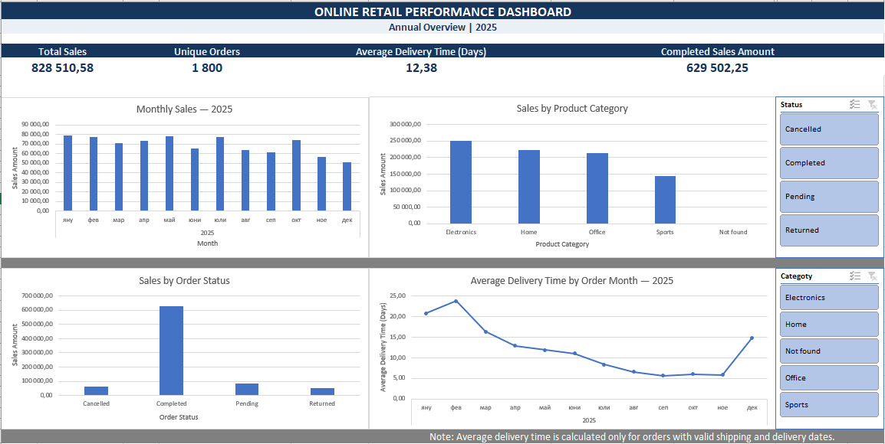

# Online Retail Performance Analysis

## Project Overview

This project analyzes a fictional online retailer's order data to explore sales performance, product categories, order statuses, and delivery times.

The goal is to clean and prepare raw data, analyze business performance, and build an interactive Excel dashboard.

## Tools Used

- Microsoft Excel
- Excel formulas and data cleaning
- PivotTables and PivotCharts
- Interactive slicers
- Data quality documentation

## Business Questions

- How do sales change month by month?
- Which product categories generate the most sales?
- How are sales distributed across order statuses?
- How many unique orders are recorded?
- What is the average delivery time?

## Data Cleaning

The raw dataset contained inconsistent date formats, missing values, and text-quality issues.

The cleaning process included:

- Standardizing and validating dates
- Investigating missing CustomerID and ProductID values
- Recovering some missing quantities and line amounts when supported by the available data
- Standardizing status text
- Checking shipping and delivery date sequences
- Calculating delivery time in days
- Documenting cleaning decisions and unresolved issues

The original raw data was preserved separately from the cleaned dataset.

## Dashboard

The interactive dashboard includes four KPI cards:

- Total Sales
- Unique Orders
- Average Delivery Time
- Completed Sales Amount

It also includes four charts:

- Monthly Sales
- Sales by Product Category
- Sales by Order Status
- Average Delivery Time by Order Month

Two slicers allow users to explore the dashboard by order status and product category.

## Key Findings

- Total sales: 828,510.58
- Unique orders: 1,800
- Average delivery time: 12.38 days
- Completed sales amount: 629,502.25

Electronics generated the highest sales among the product categories. Completed orders accounted for the largest share of recorded sales.

## Data Limitations

One record has an unresolved ProductID and LineAmount, so its product category and sales amount cannot be reliably recovered.

Some orders have no shipping or delivery dates. Average delivery time is calculated only for records with valid shipping and delivery dates. Missing delivery times were not treated as zero.

Date corrections relied on documented assumptions where the original date format was ambiguous.

## Files

- `online_retail_performance.xlsx` — Excel workbook containing raw data, cleaned data, data quality documentation, analysis, and dashboard
- `screenshots/dashboard.png` — dashboard screenshot

## Notes

This project uses fictional sample data for learning and portfolio demonstration. Findings describe this sample dataset and should not be interpreted as actual company performance.

## Interactive Tableau Dashboard

Explore the interactive dashboard published on Tableau Public:

[View the Tableau Dashboard] (https://public.tableau.com/app/profile/ivayla.emilova/viz/Online_Retail_Performance_Tableau/OnlineRetailPerformanceDashboard)

The dashboard includes:
- Total Sales, Unique Orders, Average Delivery Time, and Completed Sales KPIs
- Monthly Sales Analysis
- Sales by Product Category and Order Status
- Top 10 Products by Sales
- Interactive Category and Order Status filters
